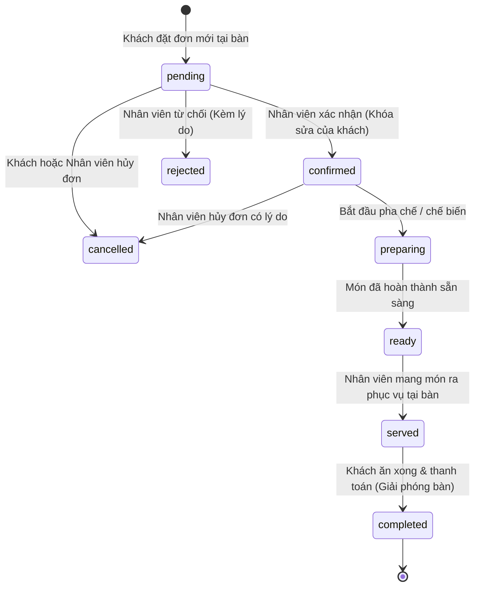

# HỆ THỐNG QUẢN LÝ ORDER ĐỒ ĂN & ĐỒ UỐNG (SINGLE-STORE POS)

Dự án website quản lý gọi món tại bàn và xử lý đơn hàng thời gian thực cho một cửa hàng cà phê / nhà hàng (Single-Store). Hệ thống hỗ trợ khách quét mã QR tại bàn để xem menu và đặt món; nhân viên nhận đơn, điều chỉnh và thanh toán; quản trị viên quản lý toàn bộ thực đơn, bàn, nhân sự và báo cáo doanh thu.

---

## 🛠 CÔNG NGHỆ SỬ DỤNG

- **Backend**: Node.js, Express.js
- **Database**: MongoDB, Mongoose ODM
- **Xác thực**: JWT (Access Token & Refresh Token lưu HTTP-Only Cookie + Header Bearer), mã hóa mật khẩu bằng `bcryptjs`
- **Realtime**: Socket.IO (phát chuông âm thanh và cập nhật trạng thái đơn thời gian thực)
- **Giao diện**: EJS Render phía Server kết hợp Bootstrap 5, FontAwesome 6, SweetAlert2, Web Audio API
  > **Lý do chọn EJS**: Kiến trúc nguyên khối (Monolith) tập trung toàn bộ server API và giao diện trong 1 repository, giúp cài đặt, khởi chạy (`npm run dev`) và bàn giao tức thì chỉ với một lệnh duy nhất mà không cần quản lý riêng biệt 2 máy chủ client-server.
- **Validate & Security**: Joi validation, Helmet, CORS, Morgan, Express-Rate-Limit
- **Upload & Tiện ích**: Multer (lưu ảnh cục bộ hoặc Cloudinary), QRCode (sinh mã QR động cho từng bàn), ExcelJS (xuất báo cáo Excel).

---

## 👥 PHÂN QUYỀN VÀ TÀI KHOẢN MẪU

Dữ liệu được nạp sẵn qua lệnh `npm run seed`:

| Vai trò | Email | Mật khẩu | Chức năng chính |
| :--- | :--- | :--- | :--- |
| **Quản trị viên (Admin)** | `admin@orderapp.com` | `Admin@123` | Toàn quyền quản trị: Thống kê doanh thu, CRUD món ăn, danh mục, bàn ăn, nhân viên, xuất Excel, xem audit log. |
| **Nhân viên thu ngân (Staff 1)** | `staff1@orderapp.com` | `Staff@123` | Nhận đơn realtime có chuông báo, xác nhận/từ chối, sửa món trong đơn (ghi log), đổi trạng thái, thanh toán thu tiền. |
| **Nhân viên phục vụ (Staff 2)** | `staff2@orderapp.com` | `Staff@123` | Theo dõi đơn pha chế, đổi trạng thái sang sẵn sàng / đang phục vụ. |
| **Khách hàng thân thiết** | `customer@gmail.com` | `Customer@123` | Xem lịch sử đơn hàng, lưu thông tin liên hệ. |
| **Khách vãng lai** | *Không cần đăng nhập* | *Quét QR bàn* | Chọn bàn, chọn món, tùy chọn size/đường/đá/topping, sửa/xóa/hủy khi pending, gọi thêm món. |

---

## ⚡ HƯỚNG DẪN CÀI ĐẶT & KHỞI CHẠY

### 1. Yêu cầu môi trường
- Node.js >= 18.x (Đã kiểm thử trên v22.19.0)
- MongoDB Server đang chạy tại cổng `27017` (hoặc cấu hình URI qua `.env`)

### 2. Cài đặt thư viện
```bash
npm install
```

### 3. Cấu hình biến môi trường
File `.env` đã được thiết lập sẵn mặc định. Bạn có thể tham khảo `.env.example`:
```ini
PORT=3000
NODE_ENV=development
CLIENT_URL=http://localhost:3000
MONGO_URI=mongodb://localhost:27017/order_management
JWT_SECRET=super_secret_order_app_jwt_key_2026_xyz
JWT_EXPIRES_IN=1h
REFRESH_SECRET=super_secret_refresh_token_key_2026_xyz
REFRESH_EXPIRES_IN=7d
UPLOAD_DIR=public/uploads
```

### 4. Nạp dữ liệu mẫu (Seed Data)
Tạo sẵn tài khoản Admin, Nhân viên, 10 Bàn ăn, 4 Danh mục, 9 Món ăn kèm Options:
```bash
npm run seed
```

### 5. Khởi chạy ứng dụng
Chạy ở chế độ phát triển (tự động reload khi code thay đổi):
```bash
npm run dev
```
Hoặc chạy chế độ thông thường:
```bash
npm start
```
Truy cập trình duyệt: **`http://localhost:3000`**

### 6. Chạy bộ kiểm thử tự động (Unit / Integration Tests)
```bash
npm test
```

---

## 🔄 SƠ ĐỒ CHUYỂN TRẠNG THÁI ĐƠN HÀNG (STATE MACHINE)



### Quy tắc luồng:
1. **Khách hàng**:
   - Chỉ được chỉnh sửa số lượng, ghi chú hoặc xóa món, hủy đơn khi đơn còn ở trạng thái `pending` (`isLocked = false`).
   - Sau khi nhân viên xác nhận (`confirmed`), đơn tự động khóa chỉnh sửa `isLocked = true`.
   - Khách có thể **Gọi thêm món** (tạo đợt gọi mới `addedRound + 1`), các món gọi thêm sẽ ở trạng thái chờ nhân viên duyệt.
2. **Nhân viên**:
   - Khi chỉnh sửa (thêm/sửa/xóa) món trong đơn của khách, hệ thống tự động ghi nhật ký vào `order_logs` với dữ liệu trước và sau thay đổi (`before`, `after`) và tính lại tiền.
   - Trạng thái chỉ được đi tới theo luồng hợp lệ, không được nhảy bước tùy tiện.
   - Khi đơn chuyển sang `completed`, bàn tự động chuyển về trạng thái `empty` (trống) và tăng `soldCount` cho các món ăn.

---

## 📡 SỰ KIỆN REALTIME (SOCKET.IO)

Hệ thống phân chia các room:
- `room_staff`: Nhận thông báo đơn mới, gọi thêm món, thay đổi món.
- `room_admin`: Nhận toàn bộ cập nhật đơn hàng và cảnh báo kho.
- `order:{orderId}`: Khách theo dõi cập nhật đơn hàng của chính mình.
- `table:{tableNumber}`: Các thiết bị cùng bàn cập nhật đồng bộ.

| Sự kiện | Chi tiết phát | Người nhận |
| :--- | :--- | :--- |
| `order:new` | Có đơn hàng mới hoặc đợt gọi thêm món | Staff, Admin |
| `order:status-changed` | Đơn chuyển trạng thái (kèm lý do nếu có) | Khách tại bàn, Staff, Admin |
| `order:updated` | Cập nhật số lượng món, tiền hoặc thêm món | Khách tại bàn, Staff |
| `product:availability-changed` | Đổi trạng thái còn hàng / tạm hết hàng | Toàn bộ khách và nhân viên |

---

## 🌐 DANH SÁCH API (REST ENDPOINTS)

### 1. Xác thực (Auth)
- `POST /api/auth/register` - Đăng ký tài khoản khách hàng
- `POST /api/auth/login` - Đăng nhập (khách / staff / admin)
- `POST /api/auth/refresh-token` - Cấp mới access token từ refresh token
- `POST /api/auth/logout` - Đăng xuất & thu hồi token
- `GET /api/auth/profile` - Lấy thông tin cá nhân hiện tại
- `PUT /api/auth/change-password` - Đổi mật khẩu

### 2. Khách hàng (Customer / Public)
- `GET /api/customer/categories` - Danh sách danh mục món đang bán
- `GET /api/customer/products` - Danh sách món (tìm kiếm, lọc danh mục, phân trang)
- `GET /api/customer/products/:id` - Xem chi tiết món và các options (size, đường, đá, topping)
- `GET /api/customer/tables/:tableNumber` - Xem thông tin bàn
- `POST /api/customer/coupons/validate` - Kiểm tra tính hợp lệ và giá trị giảm của coupon
- `POST /api/customer/orders` - Đặt đơn hàng mới gắn với bàn
- `GET /api/customer/orders/code/:code` - Xem thông tin đơn theo mã `orderCode`
- `POST /api/customer/orders/:id/items` - Gọi thêm món cho đơn đang phục vụ
- `PUT /api/customer/orders/:id/items/:itemId` - Sửa số lượng / ghi chú món khi pending
- `DELETE /api/customer/orders/:id/items/:itemId` - Xóa món khỏi đơn khi pending
- `POST /api/customer/orders/:id/cancel` - Khách hủy đơn hàng khi pending
- `GET /api/customer/orders/my-orders` - Lịch sử đơn hàng của khách đã đăng nhập

### 3. Nhân viên (Staff - Yêu cầu role Staff hoặc Admin)
- `GET /api/staff/orders` - Danh sách đơn theo bộ lọc trạng thái, bàn, ngày
- `GET /api/staff/orders/:id` - Chi tiết đơn hàng và lịch sử thao tác
- `POST /api/staff/orders/:id/confirm` - Tiếp nhận và xác nhận đơn
- `POST /api/staff/orders/:id/reject` - Từ chối đơn (kèm lý do)
- `PUT /api/staff/orders/:id/status` - Chuyển trạng thái đơn (`preparing`, `ready`, `served`)
- `POST /api/staff/orders/:id/modify-items` - Thêm / sửa / xóa món trong đơn (ghi log)
- `POST /api/staff/orders/:id/pay` - Thu tiền thanh toán (tiền mặt / chuyển khoản / thẻ)
- `PUT /api/staff/products/:id/availability` - Bật / tắt còn hàng tạm thời
- `GET /api/staff/tables` - Danh sách trạng thái bàn ăn

### 4. Quản trị viên (Admin - Yêu cầu role Admin)
- `GET, POST, PUT, DELETE /api/admin/categories` - Quản lý danh mục món ăn
- `GET, POST, PUT, DELETE /api/admin/products` - Quản lý món ăn kèm upload ảnh
- `GET, POST, PUT, DELETE /api/admin/tables` - Quản lý bàn ăn
- `POST /api/admin/tables/:id/regenerate-qr` - Sinh lại mã QR cho bàn
- `GET, POST /api/admin/staff` - Quản lý danh sách nhân viên
- `PUT /api/admin/staff/:id/toggle-status` - Khóa / mở khóa tài khoản nhân viên
- `PUT /api/admin/staff/:id/reset-password` - Đặt lại mật khẩu nhân viên
- `GET /api/admin/reports/overview` - Báo cáo tổng quan doanh thu, số đơn, top món
- `GET /api/admin/reports/revenue-chart` - Dữ liệu biểu đồ doanh thu theo ngày
- `GET /api/admin/reports/export-excel` - Xuất file Excel toàn bộ đơn hàng
- `GET /api/admin/reports/audit-logs` - Xem toàn bộ nhật ký thao tác hệ thống

---

## 📂 CẤU TRÚC THƯ MỤC

```
order-management/
├── src/
│   ├── config/            (db.js, env.js, socket.js)
│   ├── models/            (User, Category, Product, Table, Order, OrderLog, Coupon, index.js)
│   ├── controllers/       (auth, category, product, table, order, coupon, report, user)
│   ├── services/          (authService, categoryService, productService, tableService, orderService, couponService, reportService, qrService)
│   ├── routes/            (auth.routes, customer.routes, staff.routes, admin.routes, view.routes, index.js)
│   ├── middlewares/       (auth, role, validate, upload, errorHandler, notFound, rateLimiter)
│   ├── validators/        (auth, category, product, table, order, user, coupon)
│   ├── sockets/           (orderSocket.js)
│   ├── utils/             (apiResponse, appError, generateOrderCode, calcTotal)
│   ├── constants/         (roles, orderStatus)
│   ├── views/             (EJS templates: layouts, partials, customer, auth, staff, admin, error.ejs)
│   ├── public/            (css/style.css, js/main.js, js/sound.js, uploads/)
│   ├── seeders/           (index.js - Tạo tài khoản mẫu, danh mục, món ăn, bàn có mã QR, coupon)
│   ├── app.js             (Cấu hình Express, Security, Engine EJS, Middlewares)
│   └── server.js          (Khởi chạy HTTP server & Socket.IO)
├── tests/                 (auth.test.js, order.test.js)
├── .env.example           (Mẫu cấu hình môi trường)
├── .gitignore
├── package.json
└── README.md
```
# ProjectFER_FA26

