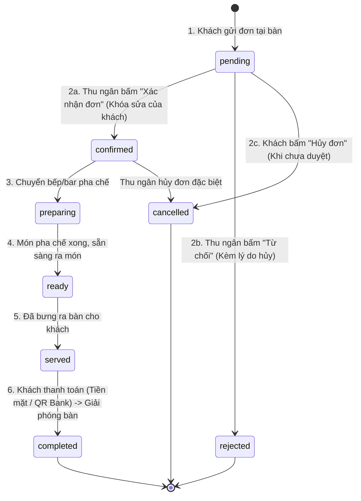
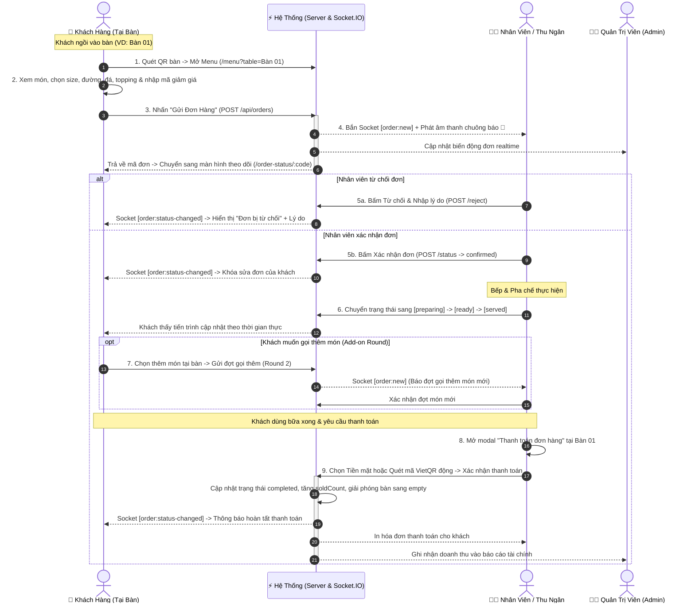

# 📋 TÀI KHOẢN HỆ THỐNG & SƠ ĐỒ QUY TRÌNH BÁN HÀNG
> **Dự án:** Hệ Thống Đặt Món & Quản Lý Quán Cà Phê / Trà Sữa (Coffee & Tea House)  
> **Môi trường cục bộ:** `http://localhost:3000`  
> **Tài liệu dùng cho:** Đánh giá, nghiệm thu, kiểm thử (Review & Testing)

---

## 🔐 PHẦN 1: DANH SÁCH TÀI KHOẢN HỆ THỐNG & MẬT KHẨU

Dữ liệu được khởi tạo mặc định trong hệ thống qua seeder (`npm run seed`):

| STT | Phân loại vai trò | Họ và tên | Email đăng nhập | Mật khẩu | Quyền hạn & Chức năng chính |
| :---: | :--- | :--- | :--- | :--- | :--- |
| **1** | **Quản trị viên (Admin)** | Quản Trị Viên | `admin@orderapp.com` | `Admin@123` | • Toàn quyền hệ thống. • Dashboard thống kê doanh thu, số đơn hàng, top món bán chạy. • Quản lý Danh mục, Món ăn (CRUD, bật/tắt món, gắn Options). • Quản lý Bàn ăn & Tải/In mã QR tự động. • Quản lý Tài khoản Nhân viên. • Quản lý Mã giảm giá (Coupon). • Xuất báo cáo doanh thu ra file Excel (.xlsx). • Xem nhật ký kiểm toán (Audit Logs) chỉnh sửa đơn. |
| **2** | **Thu ngân (Staff 1)** | Nguyễn Văn Thu Ngân | `staff1@orderapp.com` | `Staff@123` | • Truy cập Bảng điều khiển nhân viên (`/staff/dashboard`). • Nhận thông báo đơn mới realtime kèm âm thanh chuông báo. • Xác nhận (`confirmed`) hoặc Từ chối (`rejected`) đơn hàng. • Chỉnh sửa món/số lượng trong đơn (hệ thống tự động lưu audit log). • Mở modal Thu tiền & Thanh toán (Tiền mặt / Chuyển khoản VietQR), in hóa đơn, hoàn thành đơn. |
| **3** | **Phục vụ / Bếp (Staff 2)** | Trần Thị Phục Vụ | `staff2@orderapp.com` | `Staff@123` | • Theo dõi tiến độ chế biến các đơn tại bàn. • Đổi trạng thái chế biến: Đang pha chế (`preparing`) ➔ Sẵn sàng (`ready`) ➔ Đã phục vụ (`served`). |
| **4** | **Khách hàng đã đăng ký** | Khách Hàng Mẫu | `customer@gmail.com` | `Customer@123` | • Đăng nhập tại `/login`. • Tự động điền thông tin khi đặt món. • Xem lịch sử đơn hàng cá nhân tại `/orders/history`. |
| **5** | **Khách vãng lai tại bàn** | *(Khách tại bàn)* | *Không cần tài khoản* | *Không cần mật khẩu* | • Quét mã QR tại bàn hoặc truy cập link: `http://localhost:3000/menu?table=Bàn 01` (hỗ trợ từ `Bàn 01` đến `Bàn 10`). • Tự do chọn món, chọn size, lượng đường/đá/topping. • Tự hủy/sửa đơn khi nhân viên chưa duyệt (`pending`). • Gọi thêm món (`Add-on Round`) khi đang dùng bữa. |
---

## 📊 PHẦN 2: SƠ ĐỒ CHUYỂN TRẠNG THÁI ĐƠN HÀNG (STATE MACHINE)

Vòng đời đơn hàng di chuyển tuần tự qua các trạng thái nhằm đảm bảo tính toàn vẹn dữ liệu:

### Chi tiết các trạng thái:
1. **`pending` (Chờ xác nhận):** Khách vừa gửi đơn. Lúc này khách **vẫn có thể** sửa số lượng, đổi ghi chú hoặc hủy đơn ngay trên màn hình điện thoại của mình.
2. **`confirmed` (Đã xác nhận):** Thu ngân tiếp nhận đơn. Đơn **tự động khóa sửa** (`isLocked = true`) với khách để tránh trường hợp bếp đang làm mà khách lại sửa món.
3. **`preparing` (Đang chế biến):** Bếp/quầy pha chế tiếp nhận làm món.
4. **`ready` (Sẵn sàng phục vụ):** Món đã làm xong, đặt tại quầy chờ nhân viên bưng ra bàn.
5. **`served` (Đang phục vụ):** Món đã được mang ra bàn. Khách bắt đầu thưởng thức.
6. **`completed` (Hoàn thành):** Khách thanh toán tiền mặt/chuyển khoản. Đơn đóng lại, bàn đổi sang trạng thái `empty` (Trống), cộng dồn số lượng bán `soldCount` cho các món.
7. **`rejected` / `cancelled`:** Đơn bị hủy (có lưu lý do hủy và giải phóng bàn).

---

## 🔄 PHẦN 3: SƠ ĐỒ LUỒNG ĐI BÁN HÀNG TỔNG THỂ (END-TO-END WORKFLOW)

Sơ đồ thể hiện sự phối hợp nhịp nhàng giữa **Khách Hàng**, **Hệ Thống Realtime (Socket.IO)** và **Nhân Viên / Thu Ngân**:

---

## 🧭 PHẦN 4: HƯỚNG DẪN CÁC KỊCH BẢN REVIEW & TEST HỆ THỐNG

Để có trải nghiệm review trực quan nhất, bạn có thể mở **2 tab trình duyệt song song**:

* **Tab 1 (Giao diện Khách hàng tại bàn):**
  * Link: `http://localhost:3000/menu?table=Bàn 01`
* **Tab 2 (Giao diện Thu ngân / Nhân viên):**
  * Link: `http://localhost:3000/staff/dashboard` (Đăng nhập: `staff1@orderapp.com` / `Staff@123`)

---

### 🧪 Kịch bản 1: Luồng đặt món chuẩn & thanh toán (Happy Path)
1. **Tại Tab Khách (`Bàn 01`):**
   * Bấm vào món "Cà Phê Muối Hoàng Gia" ➔ Chọn size L (+10.000đ), Giảm ngọt, Thêm topping Thạch cà phê.
   * Thêm món "Trà Sữa Oolong Nướng Trân Châu".
   * Mở giỏ hàng, kiểm tra tổng tiền và ghi chú món nếu cần.
   * Nhấn **"Xác nhận đặt đơn"**.
2. **Tại Tab Nhân Viên:**
   * Ngay lập tức chuông báo vang lên 🔔 và đơn mới xuất hiện trong cột "Chờ Xác Nhận".
   * Bấm nút **"Xem & Xử lý"**.
   * Bấm **"Xác nhận đơn"** ➔ Đơn chuyển sang tab "Đã Xác Nhận".
   * Thử chuyển lần lượt sang "Đang Chế Biến", "Đã Sẵn Sàng", "Đã Ra Món".
   * Bấm nút **"Thanh Toán"** ➔ Chọn tiền mặt, nhập số tiền khách đưa ➔ Bấm **"Xác Nhận & In Hóa Đơn"**.
3. **Kết quả:** Bàn 01 trở về trạng thái trống; Doanh thu được ghi nhận ngay lập tức vào Admin Dashboard.

---

### 🧪 Kịch bản 2: Khách gọi thêm món khi đang ngồi ăn (Add-on Rounds)
1. Khi đơn bàn 01 đã ở trạng thái `served` (hoặc `confirmed`).
2. Khách vẫn tại trang `menu?table=Bàn 01` chọn thêm món "Trà Sữa Matcha Nhật Bản" và bấm **"Gọi Thêm Món"**.
3. Nhân viên nhận thông báo có đợt gọi thêm (`Round 2`), duyệt món mới mà không làm mất các món cũ.
4. Tổng tiền của đơn hàng tự động tính toán lũy kế chính xác.

---

### 🧪 Kịch bản 3: Nhân viên sửa món hộ khách (Audit Logs)
1. Khi khách muốn đổi loại nước hoặc hủy bớt món nhưng đơn đã bị khóa:
2. Nhân viên mở modal chi tiết đơn, bấm **"Chỉnh sửa món"**.
3. Thay đổi số lượng hoặc xóa món ➔ Bấm **"Lưu thay đổi"**.
4. Vào trang Quản trị (`admin@orderapp.com` tại `/admin/dashboard`) ➔ Xem mục **"Nhật Ký Kiểm Toán" (Audit Log)** sẽ thấy lịch sử ghi rõ:
   * Ai là người sửa (`staff1@orderapp.com`).
   * Sửa lúc nào.
   * Dữ liệu trước khi sửa (`before`) và sau khi sửa (`after`).

---

### 🧪 Kịch bản 4: Quản trị viên xuất báo cáo doanh thu
1. Đăng nhập tài khoản Admin: `admin@orderapp.com` / `Admin@123`.
2. Vào mục Thống kê / Báo cáo.
3. Bấm nút **"Xuất Excel Báo Cáo"** ➔ Tải về file `.xlsx` định dạng chuẩn có đầy đủ biểu đồ doanh thu, danh sách đơn hàng và danh sách món bán chạy nhất.

---

### 🧪 Kịch bản 5: Nghiệp vụ Đặt bàn trước (Table Reservation)
1. **Khách đặt chỗ trước theo giờ (`/reservation`):**
   * Khách chọn ngày đến, giờ đến, số lượng người lớn và trẻ em.
   * Khách chọn yêu cầu vị trí: **Gần cửa sổ (Window)**, **Ngoài trời (Outdoor)**, **Phòng lạnh (Indoor)** hoặc Tùy ý.
2. **Quy tắc đặt cọc giữ chỗ (200.000đ):**
   * **Nếu đặt bàn trên 10 người** HOẶC **đặt vào khung giờ cao điểm** (11:30 - 13:30 hoặc 18:00 - 20:30):
     ➔ Hệ thống tự động kích hoạt yêu cầu chuyển khoản cọc **200.000đ**.
     ➔ Sinh mã VietQR động tự động kèm thông tin ngân hàng và cú pháp `COC [MÃ ĐẶT BÀN] [SĐT]` cho khách quét app ngân hàng.
   * **Nếu không thuộc 2 điều kiện trên:** Miễn phí đặt cọc giữ chỗ.
3. **Nhân viên tiếp nhận & Xếp bàn (`/staff/dashboard` tab Đặt Bàn Trước):**
   * Nhân viên nhận chuông thông báo Realtime 🔔 kèm đơn đặt bàn mới.
   * Bấm **"Xác nhận đã cọc"** khi nhận được 200.000đ tiền cọc.
   * Bấm **"Xếp Bàn"** chọn bàn phù hợp sức chứa và vị trí ➔ Bàn tự động chuyển sang trạng thái **`reserved` (Đã giữ chỗ)** trên sơ đồ bàn.
   * Khi khách có mặt tại quán: Bấm **"Khách Đã Đến (Check-in)"** ➔ Bàn chuyển sang **`occupied` (Đang phục vụ)**.
4. **Cơ chế tự động hủy giữ bàn nếu trễ quá 15 phút (No-show):**
   * Quá thời gian đặt hẹn **15 phút** mà khách không đến nhận bàn (`now > reservationTime + 15m`):
     ➔ Hệ thống (Background Worker chạy mỗi phút hoặc nút bấm thủ công "Quét Quá Hạn 15P") tự động chuyển trạng thái đơn sang **`no_show`**.
     ➔ Bàn đã giữ chỗ tự động được giải phóng chuyển về **`empty` (Bàn trống)** để sẵn sàng đón khách vãng lai.
     ➔ Socket.IO bắn cảnh báo Realtime tới nhân viên thu ngân và quản trị viên.
